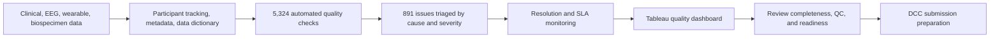
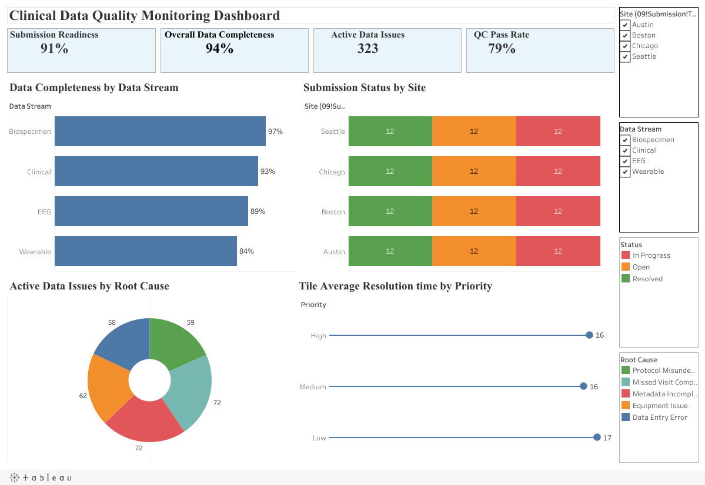

# Clinical Data Quality Monitoring & Management System

A clinical data-management case study focused on study data quality from collection through Data Coordinating Center (DCC) submission.

## Business question

How can study teams find incomplete records, QC failures, and submission blockers early across research sites and data streams?

## My role

Designed the clinical data management workflow across MS Access and Excel, then built a Tableau dashboard to monitor quality, issue triage, and submission progress.

## Study scope

- **Study scope:** Longitudinal study data model covering 300 participants across four research sites.
- **Data streams:** Clinical assessments, EEG, wearable, and biospecimen.

## Project pipeline

1. **Organize:** Standardized participant, record, and metadata tracking across study streams.
2. **Validate:** Executed 5,324 automated data-quality checks.
3. **Triage:** Tracked 891 issues by root cause and severity, with resolution and SLA monitoring.
4. **Monitor:** Built Tableau views for completeness, QC pass status, open issues, root causes, and DCC submission progress.
5. **Prepare:** Used readiness reporting to focus review before DCC submission.

## Business KPIs

| KPI / formula | Reported value | Meaning and interpretation |
|---|---:|---|
| Overall data completeness: `AVG([Completeness_Pct]) / 100` | **94%** | Average source completeness; leaves a 6-point gap to full completeness. |
| Submission readiness | **91%** | Leaves a 9-point gap; the source does not specify its calculation rule. |
| Validation checks executed | **5,324** | Number of quality checks run. |
| Issues tracked | **891** | Issues moved through triage; no target issue-rate KPI is defined. |
| Form completion flag: `IF [Form_Complete] = "Yes" THEN 1 ELSE 0 END` | Dashboard measure | Binary completion status for aggregation. |
| QC pass flag: `IF [Status Pass] = "Pass" THEN 1 ELSE 0 END` | Dashboard measure | Binary pass status for QC monitoring. |

## Model Metrics

No predictive or statistical model was reported; this is a data-quality monitoring workflow. Accuracy, AUC, and prediction error are **not applicable**. Completeness, readiness, check counts, and issue counts are operational KPIs.

## Key insights and recommendations

- **94% data completeness** leaves a 6-point gap to full completeness; use the completeness view to identify which sites/data streams contribute most to the remaining gaps.
- **91% submission readiness** leaves a 9-point gap to full readiness; resolve blockers before the next DCC submission review.
- **891 tracked issues** across **5,324 checks** make root-cause, severity, and SLA prioritization central to the workflow. The project source does not define a target issue-rate KPI, so these counts are not converted into one.

Recommended next steps are to focus QC follow-up on the largest completeness gaps, triage high-severity or overdue issues first, and confirm readiness criteria with the DCC before submission. These are workflow recommendations; the project does not claim measured post-implementation outcomes.
## Dashboard preview

## Business value

The workflow gives study teams a consistent view of data completeness, QC, unresolved issues, and submission readiness. The reported figures describe this project and are not clinical outcome claims.

## Portfolio evidence

## Project files

- `data/Clinical_Data_Liaison_LNHS_Workbook.xlsx` — Excel source workbook used by the dashboard.
- `assets/` — selected dashboard images from Tableau Public.

## Supporting documents

- [Executive summary](docs/Executive-Summary.md)
- [Business requirements summary](docs/BRD-Summary.md)
- [Functional requirements summary](docs/FRD-Summary.md)
