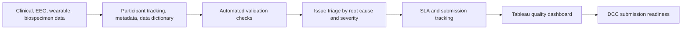

# Clinical Data Quality Monitoring & Management System

A simulated longitudinal autism study workflow for monitoring data quality from collection through Data Coordinating Center (DCC) submission.

## Business question

How can study teams find incomplete records, QC failures, and submission blockers early across research sites and data streams?

## My role

Designed the clinical data management workflow across MS Access and Excel, then built a Tableau dashboard to monitor quality, issue triage, and submission progress.

## Study scope

- **Study:** Simulated longitudinal study with 300 participants across four research sites.
- **Data streams:** Clinical assessments, EEG, wearable, and biospecimen.
- **Data status:** Simulation results; no real patient records are represented in this portfolio summary.

## Project pipeline

1. **Organize:** Standardized participant, record, and metadata tracking across study streams.
2. **Validate:** Executed 5,324 automated data-quality checks.
3. **Triage:** Tracked 891 issues by root cause and severity, with resolution and SLA monitoring.
4. **Monitor:** Built Tableau views for completeness, QC pass status, open issues, root causes, and DCC submission progress.
5. **Prepare:** Used readiness reporting to focus review before DCC submission.

## Measures and formulas

| Measure | Meaning and interpretation |
|---|---|
| Overall data completeness | Reported at **94%** for the simulation. Tableau converts the average source completeness score to a fraction with `AVG([Completeness_Pct]) / 100`. |
| Submission readiness | Reported at **91%**. The project summary does not specify its calculation rule, so this is presented as a reported result rather than a reconstructed formula. |
| Form completion flag | `IF [Form_Complete] = "Yes" THEN 1 ELSE 0 END` converts complete/incomplete status into a binary flag for dashboard aggregation. |
| QC pass flag | `IF [Status Pass] = "Pass" THEN 1 ELSE 0 END` marks records that passed QC for dashboard monitoring. |
| Validation checks and issues | **5,324** checks were executed and **891** data-quality issues were tracked through triage. |

## Business value

The workflow gives study teams a consistent view of data completeness, QC, unresolved issues, and submission readiness. The reported readiness and completeness figures come from a simulation; they are not production clinical outcomes.

## Portfolio evidence

This review draft contains the project summary and pipeline only. It does not include participant-level workbook data or the full project report. The local Tableau workbook depends on a separate source workbook, so the dashboard file is not included as a standalone download.

